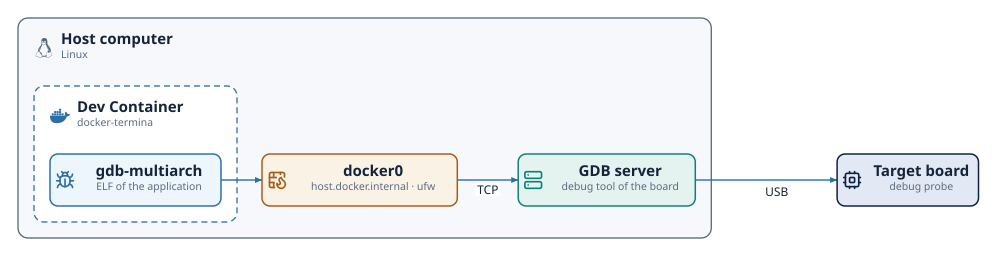

# Debugging

An application built for the `posix-gcc` platform is an ordinary native
program, so the usual debugging tools apply to it. This chapter describes how
to debug such an application with `gdb`, both from the command line and from Visual Studio Code, in the Docker-based setup that the
installation chapter recommends. The Docker image ships `gdb` for host-side
debugging and `gdb-multiarch` for the embedded targets.

With the default `release` profile, debugging operates on the generated C, not
on the Termina source: breakpoints are set on the C functions and the inspected
variables are those of the generated code. The translation scheme makes the
correspondence direct. A procedure or action named `increment` of a class `CCounter` becomes the C
function `CCounter__increment`, fields keep their names inside the generated
structs, and each task's thread runs a function named after its class, such
as `termina__task_entry__CSamplerTask`. The generated sources are in the
`output/src` tree.

## Debugging from the command line

The build for `posix-gcc` compiles with debug information and without
optimization (`-O0 -g3`), so the binary is ready for the debugger as it comes
out of `make`. After a build, the program runs under `gdb` directly:

```bash
$ cd output
$ make
$ gdb ./bin/myapp
(gdb) break CCounter__increment
(gdb) run
```

A Termina application is multi-threaded: one thread per task, plus the
runtime's own. The `gdb` commands `info threads` and `thread <n>` navigate
them, and a breakpoint on an action function stops the program on whichever
task thread executes that action.

## Debugging the Termina source

Setting `profile: debug` in `termina.yaml` makes the transpiler precede each
generated statement with a `#line` directive that names the Termina file and
line it comes from. The debug information of the binary then refers to the
`.fin` sources instead of the generated C, so a breakpoint can be placed on a
line of a module:

```bash
(gdb) break hello_world.fin:12
Breakpoint 1 at 0x663b: file src/tasks/hello_world.fin, line 12.
```

The same profile defines `TERMINA__PROFILE__DEBUG` in the generated
`config.h`. With this macro defined, the runtime stops at a breakpoint before it
restarts the system, so the state that led to the restart, such as an
exception, can still be inspected. On `posix-gcc` the runtime prints the backtrace and raises
`SIGTRAP`, which stops the program under `gdb` and terminates it when no
debugger is attached. The default profile, `release`, emits neither the `#line`
directives nor the macro.

## Debugging inside the Dev Container

For the container-based workflow, debugging requires two adjustments to the
configuration shown in the installation chapter, both in
`.devcontainer/devcontainer.json`. Docker blocks the `ptrace` system call by
default, which `gdb` needs to attach to a process, so the container must be
granted it:

```jsonc
{
  "name": "Termina dev container",
  "image": "ghcr.io/termina-lang/docker-termina:latest",
  "runArgs": ["--cap-add=SYS_PTRACE", "--security-opt", "seccomp=unconfined"],
  "customizations": {
    "vscode": {
      "extensions": ["termina-lang.termina", "ms-vscode.cpptools"]
    }
  },
  "remoteUser": "vscode"
}
```

The `ms-vscode.cpptools` extension supplies the debugger integration for the
generated C. With the container rebuilt, a launch configuration in
`.vscode/launch.json` runs the compiled binary under `gdb`:

```jsonc
{
  "version": "0.2.0",
  "configurations": [
    {
      "name": "Debug (posix-gcc)",
      "type": "cppdbg",
      "request": "launch",
      "program": "${workspaceFolder}/output/bin/myapp",
      "cwd": "${workspaceFolder}/output",
      "MIMode": "gdb",
      "setupCommands": [
        { "text": "set startup-with-shell off" }
      ]
    }
  ]
}
```

In a container without a controlling terminal, `gdb` fails to launch the
program with the message "GDB failed to set controlling terminal"; the
`set startup-with-shell off` command avoids that failure. Breakpoints
are then set by clicking in the generated C files under `output/src`, and the
debugging session behaves as it would for any C program.

## Debugging on a board

On the embedded platforms, `gdb-multiarch` runs in the container and controls
the board through the GDB server of the board's debug tool. The server runs on
the host, which has the USB connection to the debug probe of the board:

| Platform | GDB server on the host | Default port |
|---|---|---|
| `rtems5-leon3sf-nexysa7` | [GRMON](https://www.gaisler.com/products/grmon3) | 2222 |
| `rtems6-zynq7000-pynqz2` | `hw_server` of [AMD Vitis](https://www.amd.com/en/products/software/adaptive-socs-and-fpgas/vitis.html) | 3000 |
| `freertos10-stm32l432-nucleol432kc` | `ST-LINK_gdbserver` of [STM32CubeCLT](https://www.st.com/en/development-tools/stm32cubeclt.html) | 61234 |

{ .diagram }

The `.devcontainer/devcontainer.json` that `termina new --vscode` generates
starts the container with `--add-host=host.docker.internal:host-gateway`,
which maps the name `host.docker.internal` to the address of the host on the
`docker0` bridge of Docker. For these platforms, the generated
`.vscode/launch.json` connects `gdb-multiarch` to the GDB server at that name
and at the port of the table. Before each session, VS Code asks for the
address of the server, with that one as the default, so that a server on
another machine or port can be given. Once connected, the `load` command writes
the program to the board.

On a Linux host with `ufw`, the default policy drops the connections that come
from the containers through `docker0`, and `gdb-multiarch` cannot reach the
server. The following rule opens the default ports of the three servers on the
bridge:

```bash
$ sudo ufw allow in on docker0 to any port 2222,3000,61234 proto tcp
```

A server started on another port needs that port in the rule.

## Keeping the container image current

The following behaviors of the container tooling can leave a debugger or
toolchain different from the one expected:

- Pulling a newer image with `docker pull` does not affect an existing Dev
  Container, which continues to run on the image it was created from. After
  an image update, the container must be recreated with the **Dev
  Containers: Rebuild Container** command.
- The `latest` and `MAJOR.MINOR` tags are mutable: they move with each
  release. A project that must behave identically over time, such as the
  material of a course, should pin the exact release tag, for instance
  `ghcr.io/termina-lang/docker-termina:v0.6.0`.
