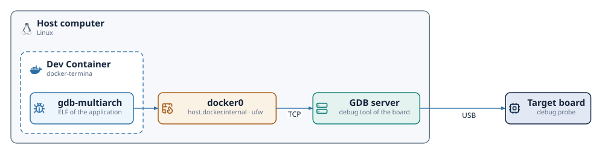

# Debugging

An application built for the `posix-gcc` platform is an ordinary native
program, so the usual debugging tools apply to it. This chapter describes how
to debug such an application with [`gdb`](https://www.sourceware.org/gdb/),
both from the command line and from Visual Studio Code, in the Docker-based setup that the
installation chapter recommends. The Docker image ships `gdb` for host-side
debugging and `gdb-multiarch` for the embedded targets.

The transpiler precedes each generated statement with a `#line` directive that
names the Termina file and line it comes from. The debug information of the
binary therefore refers to the `.fin` sources instead of the generated C, so a
breakpoint can be placed on a line of a module. The names of the generated C
remain those of the Termina program: a procedure or action named `increment`
of a class `CCounter` becomes the C function `CCounter__increment`, fields keep
their names inside the generated structs, and each task's thread runs a
function named after its class, such as `termina__task_entry__CSamplerTask`.
The generated sources are in the `output/app/src` tree.

## Debugging from the command line

The `release` profile compiles with optimization and debug information
(`-O2 -g`), and the `debug` profile without optimization and with the
information of macros (`-O0 -g3`). The binary of either profile can be debugged,
although in a `release` build the optimizer may remove variables and reorder
statements. After a build, the program runs under `gdb` directly:

```bash
$ termina build
$ gdb ./output/app/bin/hello_world
(gdb) break hello_world.fin:11
Breakpoint 1 at 0x663b: file src/tasks/hello_world.fin, line 11.
(gdb) break CHelloWorldTask__timeout
(gdb) run
```

A Termina application is multi-threaded: one thread per task, plus the
runtime's own. The `gdb` commands `info threads` and `thread <n>` navigate
them, and a breakpoint on an action function stops the program on whichever
task thread executes that action.

## The debug profile

Setting `profile: debug` in the `app` section of `termina.yaml`, besides
disabling optimization, defines `TERMINA__PROFILE__DEBUG` in the generated
`config.h`. With this macro defined, the runtime stops at a breakpoint before
it restarts the system, so the state that led to the restart, such as an
exception, can still be inspected. On `posix-gcc` the runtime prints the
backtrace and raises `SIGTRAP`, which stops the program under `gdb` and
terminates it when no debugger is attached. The `release` profile does not
define the macro.

## Debugging inside the Dev Container

Docker blocks by default the `ptrace` system call, which `gdb` needs to control
a process, so the `.devcontainer/devcontainer.json` that `termina new --vscode`
writes grants it to the container. The same file lists the
`ms-vscode.cpptools` extension, which supplies the debugger integration, next
to the Termina extension:

```jsonc
{
    "name": "myapp",
    "image": "ghcr.io/termina-lang/docker-termina:0.7",
    "runArgs": [
        "--cap-add=SYS_PTRACE",
        "--security-opt", "seccomp=unconfined",
        "--add-host=host.docker.internal:host-gateway"
    ],
    "customizations": {
        "vscode": {
            "extensions": ["termina-lang.termina", "ms-vscode.cpptools"]
        }
    },
    "remoteUser": "vscode"
}
```

The `.vscode/launch.json` holds a single configuration of type `termina`,
the same for every platform:

```jsonc
{
    "version": "0.2.0",
    "configurations": [
        { "name": "Debug", "type": "termina", "request": "launch" }
    ]
}
```

When a session starts, the Termina extension builds the application with the
`debug` profile and starts a `cppdbg` session of the C/C++ extension for the
platform of the manifest. On `posix-gcc` the session runs the binary under
`gdb`. Breakpoints are set by clicking on the lines of the `.fin` modules, or
of the generated C files under `output/app/src`. The command **Run Without
Debugging** builds the application with the profile of the manifest and runs
it in a terminal of the editor, on `posix-gcc` only.

## Debugging from Visual Studio Code without the container

With a native installation, the Termina extension runs in Visual Studio Code
on the host and uses the same `launch.json`. It requires the
[C/C++ extension](https://marketplace.visualstudio.com/items?itemName=ms-vscode.cpptools),
which is not installed together with the Termina extension: the first
debugging session offers to install it when it is missing. On `posix-gcc`
the session uses [`lldb`](https://lldb.llvm.org/) on macOS and `gdb` on
Linux, and on the boards
`gdb-multiarch`.

The extension runs the `termina` found in the `PATH`. The settings of the
extension, which describe the machine and therefore belong to the user
settings rather than to the project, give another location for it and for the
rest of the installation:

| Setting | Purpose |
|---|---|
| `termina.path` | The `termina` executable, `termina` by default |
| `termina.osalDir` | The folder of the OSAL, passed as `TERMINA_OSAL_DIR` |
| `termina.toolchains.rccDir`, `termina.toolchains.rtems6Dir`, `termina.toolchains.armNoneEabiDir` | The folders of the toolchains, passed as `TERMINA_RCC_DIR`, `TERMINA_RTEMS6_DIR` and `TERMINA_ARM_NONE_EABI_DIR` |
| `termina.debug.gdbHost` | The host of the GDB servers of the boards |
| `termina.debug.gdbPath` | The debugger of the boards, `gdb-multiarch` by default |

A setting left empty keeps the value of the environment, so a toolchain folder
already exported in the shell does not have to be repeated.

## Debugging on a board

On the embedded platforms, `gdb-multiarch` runs in the container and controls
the board through the GDB server of the board's debug tool. The server runs on
the host, which has the USB connection to the debug probe of the board:

| Platform | GDB server on the host | Tested version | Default port |
|---|---|---|---|
| [`rtems5-leon3sf-nexysa7`](../platforms/nexys-a7.md) | [GRMON](https://www.gaisler.com/products/grmon3) | 4.1.2 | 2222 |
| [`rtems6-noel32im-artya7`](../platforms/arty-a7.md) | [GRMON](https://www.gaisler.com/products/grmon3) | 4.1.2 | 2222 |
| [`rtems6-zynq7000-pynqz2`](../platforms/pynq-z2.md) | `hw_server` of [AMD Vitis](https://www.amd.com/en/products/software/adaptive-socs-and-fpgas/vitis.html) | 2026.1.1 | 3000 |
| [`freertos10-stm32l432-nucleol432kc`](../platforms/nucleo-l432kc.md) | `ST-LINK_gdbserver` of [STM32CubeCLT](https://www.st.com/en/development-tools/stm32cubeclt.html) | 1.19.0 | 61234 |
| [`rtems6-rv32im-spike`](../platforms/spike.md) | [OpenOCD](https://openocd.org/), connected to Spike | xPack 0.12.0-7 | 3333 |

The page of each platform gives the command that starts its server and what
the board needs before a program is loaded. `termina platforms --json` lists,
for each platform, the address of its server and the GDB commands that load a
program into it.

{ .diagram }

The `.devcontainer/devcontainer.json` that `termina new --vscode` generates
starts the container with `--add-host=host.docker.internal:host-gateway`,
which maps the name `host.docker.internal` to the address of the host on the
`docker0` bridge of Docker. Inside the container, `termina platforms --json` gives
the servers at that name and at the port of the table, and outside it at
`localhost`. The session of the
extension connects `gdb-multiarch` to the server of the platform and runs the
commands that load the program. On the PYNQ-Z2, the extension first has the
XSDB server run the script of `xsdb-init` of the manifest, as `termina test`
does. The setting `termina.debug.gdbHost` of VS Code gives another host for
the servers.

On a Linux host with `ufw`, the default policy drops the connections that come
from the containers through `docker0`, and `gdb-multiarch` cannot reach the
server. The following rule opens on the bridge the default ports of the
servers of the table and the one of the XSDB server of the PYNQ:

```bash
$ sudo ufw allow in on docker0 to any port 2222,3000,3122,3333,61234 proto tcp
```

A server started on another port needs that port in the rule.

## Keeping the container image current

The following behaviors of the container tooling can leave a debugger or
toolchain different from the one expected:

- Pulling a newer image with `docker pull` does not affect an existing Dev
  Container, which continues to run on the image it was created from. After
  an image update, the container must be recreated with the **Dev
  Containers: Rebuild Container** command.
- The `latest` and `MAJOR.MINOR` tags are mutable: they move with each
  release. A project that must behave identically over time, such as the
  material of a course, should pin the exact release tag, for instance
  `ghcr.io/termina-lang/docker-termina:v0.7.0`.
